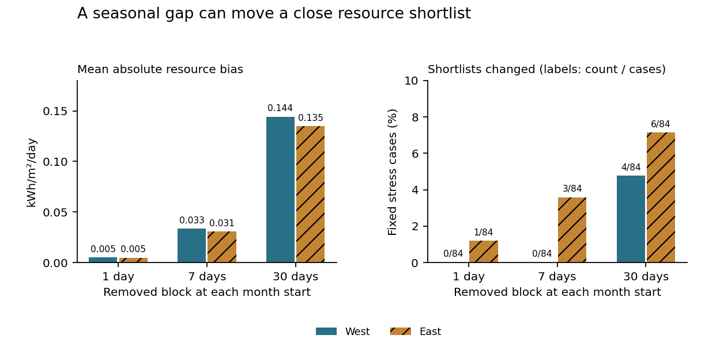
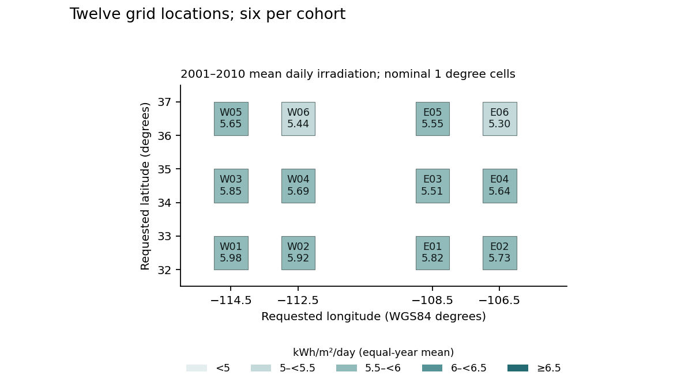

# Check a solar-resource shortlist

Check whether a small resource ranking difference survives another year and a gap in the daily record before treating it as a project decision. This study compares six simple history-only rules at twelve Southwest grid locations using NASA POWER radiation estimates.

**Finding:** the development-selected ten-year mean has zero held shortlist regret in the western group and 0.005710 kWh/m²/day in the eastern group. Every candidate gets the western pair right in all seven held years; four rules share the same eastern shortlist score. This study does not establish a unique decision advantage for the selected rule.

**Coverage check:** a fixed 30-day removal changes 4 of 84 western and 6 of 84 eastern shortlists. Average absolute resource bias is 0.144 and 0.135 kWh/m²/day. Even a one-day removal changes one close eastern comparison. These are artificial common-calendar removals from complete records, not estimated outage probabilities.



The practical output is a reproducible review of close alternatives and coverage. Obtain finer site measurements, land and connection constraints, system design, costs and tariffs before choosing a physical project. No plant generation, financial return, actual saving, deployment or source-accuracy improvement is measured.

Read the [six-page independent manuscript](paper/manuscript.pdf) for the source limits and complete results. It is not peer reviewed. The [precollection protocol](PROTOCOL.md) and [unit binding](UNIT_BINDING.md) retain the information boundary and source-unit clarification.

## What was compared

The twelve deliberately chosen points have latitudes 32.5, 34.5 and 36.5 degrees. Western longitudes are −114.5 and −112.5; eastern longitudes are −108.5 and −106.5. They are requested grid locations, not measured stations, physical parcels or a probability sample. The source uses nominal one-degree solar cells; returned coordinates and distinct full series do not establish independent spatial errors.



Six fixed candidates: last year; trailing means over 3, 5 and 10 years; trailing 10-year median; nearest-rank 20th percentile over 10 years. Each target uses strictly earlier annual resource at that point. Western 2011–2016 development selects mean 10 years by the declared MAE tie-break after five candidates tie on shortlist regret. Twenty-eight dependency hashes were committed at `97276d1` before 2017–2023 held outcomes in either group. Earlier eastern local history is an allowed input, with no eastern outcome tuning.

| Held candidate | West regret | West MAE | East regret | East MAE |
|---|---:|---:|---:|---:|
| Last year | 0 | 0.105324 | 0.022373 | 0.098910 |
| Mean 3 years | 0 | 0.081787 | 0.017327 | 0.085820 |
| Mean 5 years | 0 | 0.070974 | 0.005710 | 0.068806 |
| Mean 10 years, selected | 0 | 0.063264 | 0.005710 | 0.063032 |
| Median 10 years | 0 | 0.062065 | 0.005710 | 0.064900 |
| Q20 over 10 years | 0 | 0.075248 | 0.005710 | 0.114897 |

Units: kWh/m²/day. Regret is the target-year best pair's mean resource minus the selected pair's mean. The oracle is used only for scoring. All-point MAE answers a different question: the western median has lower held MAE than the frozen choice, while eastern Q20 has worse point error than persistence despite a better shortlist score. Every annual block, candidate, point prediction, full rank and boundary tie is retained.

## Source and missing-day design

The historical proposal named NSRDB. The actual source is NASA Langley POWER Daily API v2.10.1, SYN1DEG, UTC, 2001–2023. Twenty-four exact JSON/CSV responses were captured once under the committed request list. All 100,800 daily rows are retained; all 276 point-years are complete and all twelve points pass the fixed coverage gate. See [source manifest](data/source_manifest.json), [annual inputs](results/annual_inputs.csv), [monthly coverage](results/monthly_coverage.csv) and [point eligibility](results/point_eligibility.csv).

The API returned daily mean W/m² rather than the anticipated community energy unit. The post-capture, pre-score unit note documents the permitted integration: multiply daily mean W/m² by 24 hours and divide by 1,000 to obtain kWh/m²/day. Native values and exact converted fractions remain side by side. Fill values never become zero. This is not an untouched source-unit preregistration or a photovoltaic model.

After the core freeze, a separate four-hash stress manifest was committed at `b6df76b` before execution. Fixed blocks of 1, 7 and 30 days start on each month's first day, without wrapping across year-end. The same block applies to all six points in a cohort/year. The [3,024 point cases](results/stress_point_cases.csv) and [504 shortlists](results/stress_shortlists.csv) share records; their counts are not independent trials or probabilities. Source-complete years provide the intact reference.

## Implementation exercise

1. Choose an eastern held year from [annual scores](results/held_annual_scores.csv). Rebuild each candidate from the [point forecasts](results/held_predictions.csv) and its recorded earlier input years.
2. Recompute the two-point selection, oracle overlap and regret. Preserve exact boundary ties and the ascending-ID rule.
3. Choose a reported missing-day case and reconstruct its remaining-day denominator, resource bias and changed pair from the source projection.
4. Explain which site measurements, physical constraints and costs remain necessary. Keep radiation resource separate from electricity generation and investment returns.

## Reproduce and inspect

From a full-history checkout, Python 3.10 or 3.12:

```sh
python src/reproduce.py
python src/verify_figures.py
python -m pip install pypdf==6.10.0
python src/verify_paper.py
python src/verify_canonical_git.py
```

Core replay uses the standard library. Private-original verification and figure rebuilding use the pinned optional packages in `requirements.txt`. Replay rebuilds into separate temporary outputs and matches 96,847 CSV fields including headers and six JSON documents, runs 35 finite fixtures, verifies both committed dependency manifests and preserves original bytes. Local Python 3.10 and 3.12.14 runs pass with no source-network request.

Independent checks cover 806,558 private-original projection conditions; 19,451 input conditions; 3,394 development and 7,884 held conditions; and 41,886 fixed-removal conditions. These are field/structural checks, not independent physical observations. Figures have 48 recomputed values, 384 SVG coordinate checks, twelve map color checks and nine hashes. The manuscript has 118 checked displays and 287 checks; all six rendered pages and three figures were inspected. The retained title-width and text-qualifier checker failures were repaired without changing numerical results. See [current review receipt](REVIEW_RECEIPT.json).

## Limits and attribution

These are current retrospective source estimates with no verified original delivery vintages. Input windows overlap and held years are serially related. Restricting to 2001–2023 avoids the documented earlier SRB transition and current low-latency tail; it does not certify a homogeneous climate record. No ground-station validation, climate causality, future ranking guarantee, parcel suitability, new estimator, adoption or commercial experience is established.

Data: NASA Langley Research Center POWER project, funded through NASA Earth Science Division; Daily API v2.10.1, accessed 30 October 2026. Minimal factual values and new calculations are public; originals, source pages and unused contact metadata remain private. [Data rights](DATA_RIGHTS.md) retain source-policy and attribution boundaries. No NASA endorsement is implied. Independent program manuscripts are authorized; formal-publication projects, including Azure optimization, remain private.
